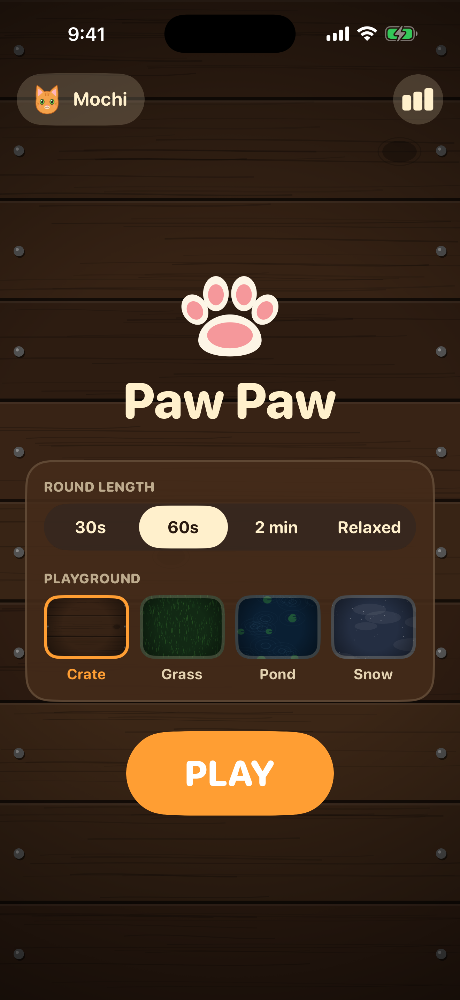
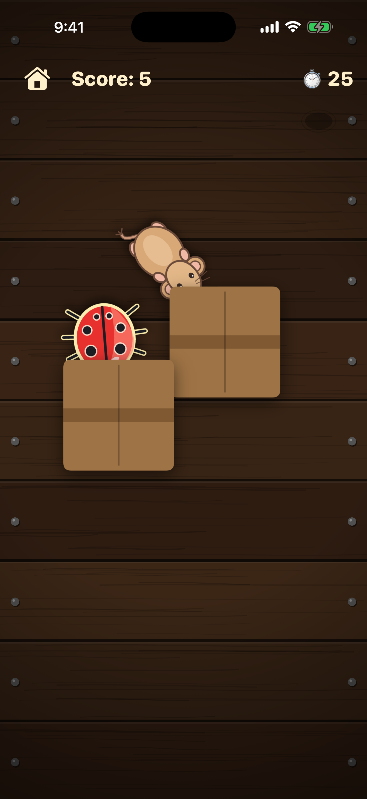
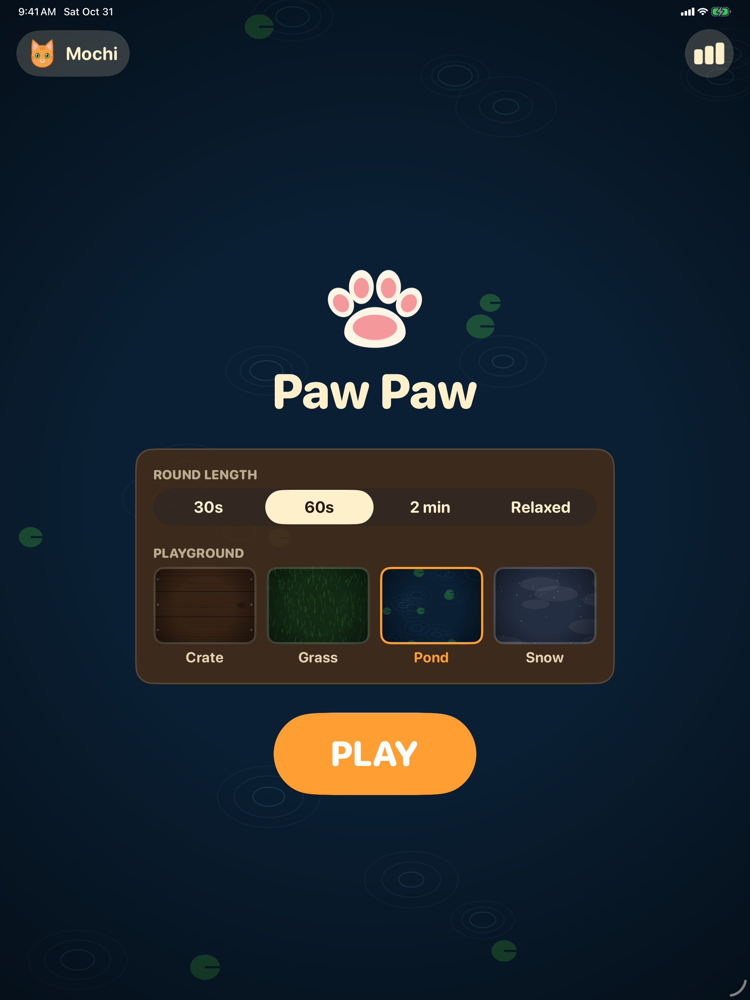
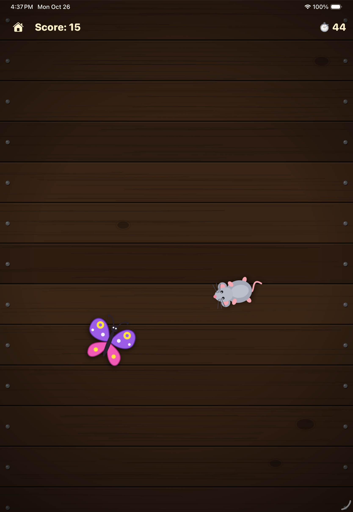

# Paw Paw 🐾

Paw Paw is a simple iOS game made **for cats**. Critters wander across a dark wooden crate, and the cat taps them with a paw to catch them before time runs out.

Built with **Swift** and **UIKit** (no storyboards or SwiftUI), following the **VIPER** architecture.

## Preview

### iPhone

| Home | Gameplay | Video
|:---:|:---:|:---:|
|  |  | https://github.com/user-attachments/assets/42b09ec8-3e3a-4238-8e96-210aef7c2d1a |


### iPad

| Home | Gameplay | Video
|:---:|:---:|:---:|
|  |  | https://github.com/user-attachments/assets/deded609-790c-484b-b927-a53345a3e72b |

## How to play

1. Pick a session length and a background on the home screen, then tap **PLAY**.
2. Tap the critters as they move across the screen. A round lasts **30 seconds**, **60 seconds** (the default) or **2 minutes**. **Relaxed** mode has no timer and never ends.
3. Each catch gives points, with a sparkle, ring and "+points" animation.
4. When time is up, you see your score and your best score for that session length. Choose **Play Again** or **Home**.

| Critter | Points | Notes |
|---|---|---|
| Mouse | 10 | Medium speed |
| Ladybug | 5 | Slowest, most common |
| Butterfly | 20 | Fastest and rare |
| Cricket | 15 | Short sudden hops with brief stops |
| Feather | 5 | Slow, gentle drifting curves |
| Laser dot | 25 | Silent glowing red dot that streaks across the field and stops dead |
| Fish | 15 | Glides and dives out of sight. Only appears on the **Pond** background |

Game design choices that suit cats:

- At most **2 critters** on screen at once, so a cat can focus on one thing.
- Critters stay on screen for several seconds. They never fade: they run in from beyond the screen edge and run off it again, and the views are reused for the next critter.
- Critters are large, drawn from above, and turn to face the direction they move.
- The background is dark so the animations stand out.
- Critters move like real prey: mice dart and freeze, bugs wander, butterflies flutter in arcs.
- Critters emerge from the screen edge, and some run off the nearest edge during a freeze, wait out of sight, then run back. Critters that are off-screen can't be caught.
- Short prey sounds (squeak, rustle, flutter, chirp, swish, catch) are synthesized in code by `SoundPlayer`. The laser dot is silent, like a real laser pointer.
- Every paw counts: several touches at once are handled, and the hit area around each critter is generous.
- Dragging a paw across a critter catches it, and leaves a trail of small ripples.
- A missed tap makes the nearest critter jump away with a squeak, so the cat always gets a reaction.
- The pace adapts to the cat (`DifficultyTuner`): each catch makes critters a little quicker, and escapes or missed taps slow them down, within 0.75× to 1.3× of normal speed. Every round starts at normal speed.
- Session lengths suit different cats: short rounds for kittens and seniors, and relaxed play with no timer for cats that like to take their time.
- Backgrounds: wooden crate, grass, pond and snow. All are dark so the critters stand out. Some critters only live on one background (`TargetKind.exclusiveTheme`), such as the fish in the pond.

For owners:

- Leaving the game needs a 1.5 second press-and-hold on the Home buttons, so paws can't exit by accident.
- The Home screen explains this, and a quick tap on an exit button shows a short reminder.
- The **Play Stats** screen shows total rounds and catches, catches per critter, a favorite critter, rounds over the last 7 days and the best score for each session length. Changes in play can hint at a change in mood or energy.
- Opening Play Stats and resetting it both need a 1.5 second press-and-hold, and a reset also asks for confirmation. Resetting keeps the best scores.
- Leaving a round early (always the case in relaxed mode) still counts the critters caught in the stats.
- The screen stays on during a round, so it won't dim or lock while the cat plays. When the result card appears, the device can sleep normally again.

Cat profiles for multi-cat households:

- Each cat has a name and a drawn headshot (orange tabby, gray tabby, black, white, calico or Siamese), and its own best scores and play stats. The first launch after the update creates a "My Cat" profile that keeps your existing scores and stats.
- The Home screen shows the active cat. Tap it to switch cats, or to add or edit one. Adding and editing use a themed card on the wood panel with a name field and a face picker, not a system alert. Deleting a cat needs a 1.5 second hold, erases its scores and stats, and the last cat can't be deleted.
- Home shows "Luna loves butterflies" once that cat has caught something, and the Stats screen is titled with the cat's name.
- The session length and background are device settings shared by all cats.

Settings, best scores and stats are saved on the device using `UserDefaults`. Each session length has its own best score for each cat. Relaxed mode has none.

## Requirements

- Xcode 26 or later
- iOS 26.0 deployment target (set in the Xcode project)

## Running the project

1. Open `pawpaw.xcodeproj` in Xcode.
2. Select the `pawpaw` scheme and an iOS simulator or device.
3. Press Run (⌘R).

Or build from the command line:

```sh
xcodebuild -project pawpaw.xcodeproj -scheme pawpaw \
  -destination 'generic/platform=iOS Simulator' build CODE_SIGNING_ALLOWED=NO
```

## Architecture (VIPER)

Each screen is a module made of five parts:

- **View**: draws the UI and reports user actions. It has no game logic.
- **Interactor**: holds the business logic and data.
- **Presenter**: connects the view and interactor, and turns data into display text.
- **Entity**: plain data models.
- **Router**: builds the module and handles navigation.

Each module's protocols are declared in a `*Protocols.swift` file. The `createModule()` function on each router wires the parts together. The presenter and interactor reference the view and each other through protocols, and the back references are `weak` to avoid retain cycles.

### Home module

| File | Role |
|---|---|
| `HomeViewController` | Title, active cat button, session length and background pickers, best score, PLAY and Stats buttons |
| `HomePresenter` | Passes the picks to the interactor, and handles the PLAY tap, the cat button and the Stats hold |
| `HomeInteractor` | Reads and saves the picked session length and background, and reads the active cat, its best score and its favorite critter |
| `HomeRouter` | Creates the module and pushes the Game, Stats or Profiles screen |

### Game module

| File | Role |
|---|---|
| `GameViewController` (+ `+Layout`) | Score and timer labels, home button, results card |
| `GameAreaView` (+ `+Effects`, `+Rings`) | The play field: moves critters, detects taps, plays catch animations |
| `GamePresenter` | Formats score, time and result text, and forwards taps |
| `GameInteractor` | Game rules: the session clock (if any), spawning (max 2 critters), scoring, saving the best score and recording stats |
| `DifficultyTuner` | Speeds critters up or slows them down based on catches, escapes and misses |
| `GameRouter` | Creates the module for a session length and returns to Home |

### Stats module

| File | Role |
|---|---|
| `StatsViewController` (+ `+Builders`) | Totals, catches per critter, 7 day chart, best scores and the hold-to-reset button |
| `StatsPresenter` | Turns the stats into display text |
| `StatsInteractor` | Reads the stats and best scores, and resets the stats |
| `StatsRouter` | Creates the module and returns to Home |

### Profiles module

| File | Role |
|---|---|
| `ProfilesViewController` (+ `+Builders`) | List of cats with their headshots and the active one checked |
| `ProfileEditorView` (+ `+Layout`, `+Builders`) | The themed add/edit card: name field, face picker, Save, Cancel and hold-to-delete |
| `ProfilesPresenter` | Turns the cats into display rows ("Loves butterflies") |
| `ProfilesInteractor` | Selects, adds, renames and deletes cats, and reads each cat's favorite critter |
| `ProfilesRouter` | Creates the module and returns to Home |

### Data flow example (catching a critter)

1. `GameAreaView` detects a tap on a critter and calls `onTapTarget`.
2. `GameViewController` passes it to `GamePresenter.didTapTarget`.
3. The presenter calls `GameInteractor.catchTarget`, which adds the points.
4. The interactor reports back to the presenter, which updates the score text and tells the view to play the catch animation.

## Project structure

```
pawpaw/
├── AppDelegate.swift, SceneDelegate.swift   App start (opens the Home module)
├── Entities/
│   ├── TargetKind.swift      Critter types: points, speed, spawn weight, image name
│   ├── GameTarget.swift      A critter on screen (kind, path, lifetime)
│   ├── GameResult.swift      Final score summary
│   ├── SessionMode.swift     Session lengths (30 s, 60 s, 2 min, relaxed)
│   ├── PlayfieldTheme.swift  Background choices
│   ├── PlayStats.swift       Lifetime play history
│   ├── CatProfile.swift      A cat's name and headshot
│   └── CatFace.swift         The drawn cat headshots, one per coat colour
├── Common/
│   ├── ProfileStorage.swift  Cats and the active cat, with first-launch migration (protocol + UserDefaults)
│   ├── ScoreStorage.swift    Best scores per cat, session length and background (protocol + UserDefaults)
│   ├── StatsStorage.swift    Play stats per cat (protocol + UserDefaults)
│   ├── CatFace+Image.swift   Draws a headshot at a given size
│   ├── Theme.swift           Colours and fonts
│   ├── WoodCrateBackgroundView.swift   Drawn wooden crate background
│   └── NatureBackgroundView.swift      Drawn grass, pond and snow backgrounds
├── Modules/
│   ├── Home/                 Home screen (VIPER)
│   ├── Game/                 Game screen (VIPER)
│   ├── Stats/                Play stats screen (VIPER)
│   └── Profiles/             Cat profiles screen (VIPER)
└── Assets.xcassets/          App assets, including the critter SVGs
```

## Art

The critter images (`critter_mouse`, `critter_bug`, `critter_butterfly`, `critter_cricket`, `critter_feather`, `critter_laser`, `critter_fish`) and the cat headshots (`cat_orange`, `cat_gray`, `cat_black`, `cat_white`, `cat_calico`, `cat_siamese`) are original SVGs drawn for this project. To use your own art, replace the SVG file inside each `.imageset` folder and keep the same filename. The backgrounds are drawn in code.

## Tweaking the game

| What | Where |
|---|---|
| Session lengths | `SessionMode.duration` |
| Background colours | `PlayfieldTheme.baseColor` |
| Max critters on screen | `GameInteractor.maxActiveTargets` |
| How often new critters spawn | `GameInteractor.spawnInterval` |
| Points, time on screen and spawn odds per critter | `TargetKind.swift` |
| Critter size | `GameAreaView.targetSize` |
| Sparkle amount | `count:` values in `GameAreaView+Effects.swift` |
| Colours | `Theme.swift` |

## Limitations

- There are no unit tests yet.
- The app has not been tested on a physical device.
- Sounds are simple synthesized tones. Phone speakers can't play the ultrasonic range that cats hear.
