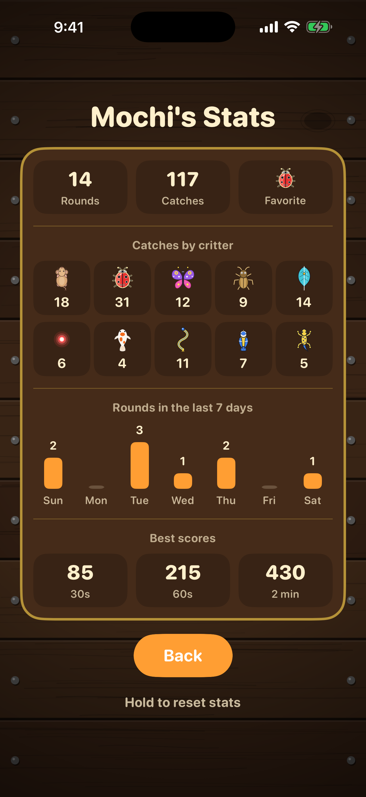
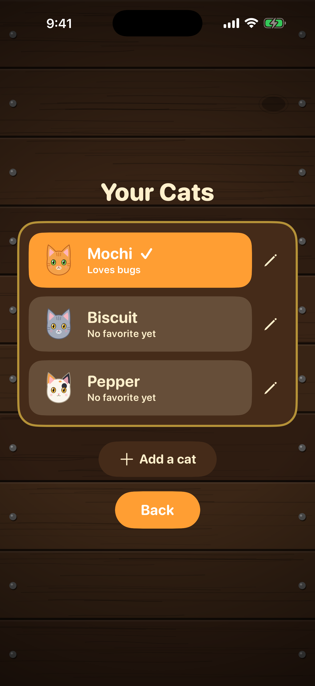
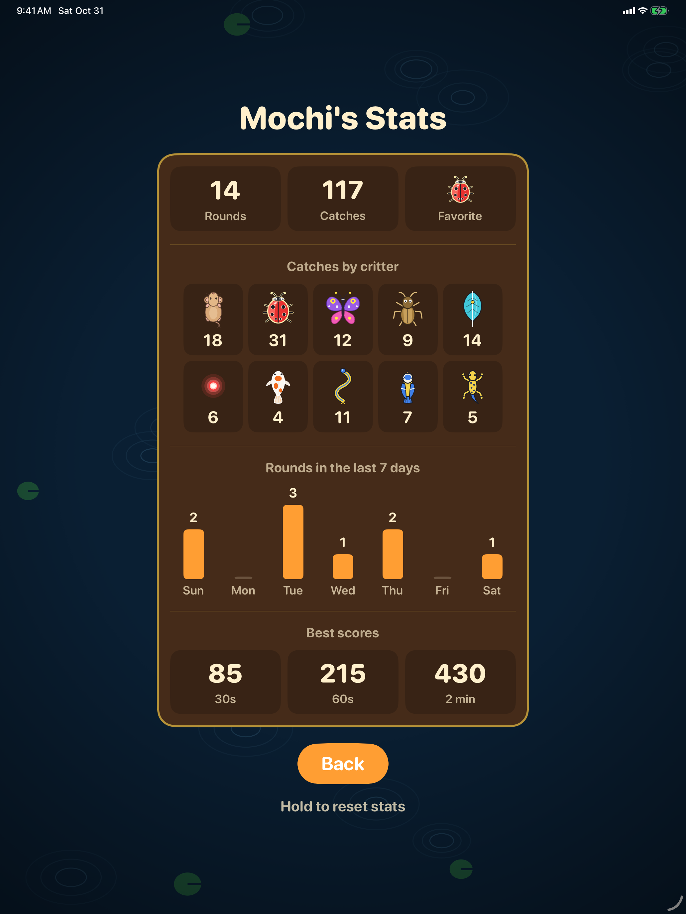
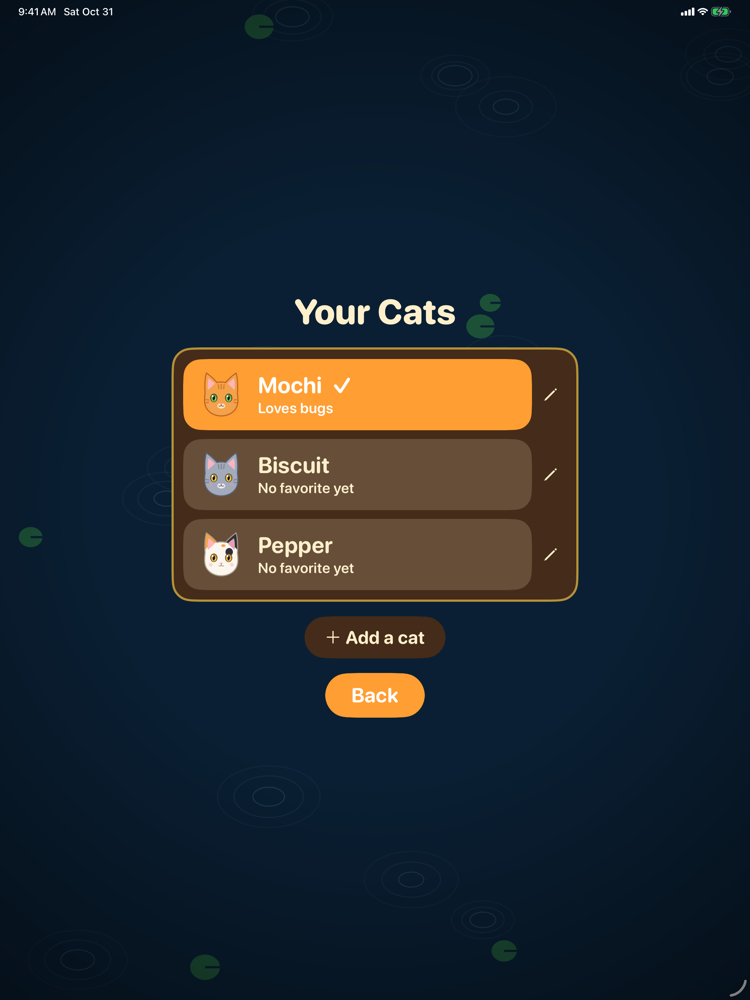

# Paw Paw 🐾

An iOS game made **for cats**. Swift, UIKit, VIPER.

## Preview

### iPhone

| Home | Gameplay | Stats | Profiles |
|:---:|:---:|:---:|:---:|
|  |  |  |  |

### iPad

| Home | Gameplay | Stats | Profiles |
|:---:|:---:|:---:|:---:|
|  |  |  |  |

https://github.com/user-attachments/assets/c6d73b0f-b67b-4074-b8f8-06a64ae1cf5a

## Play

- Round: 30 s, 60 s, 2 min or untimed Relaxed.
- Tap critters for points; hold 🏠 to leave.
- Per-cat profiles, best scores and stats.

## Docs

See [docs/](docs/README.md) for build instructions, design and architecture.
